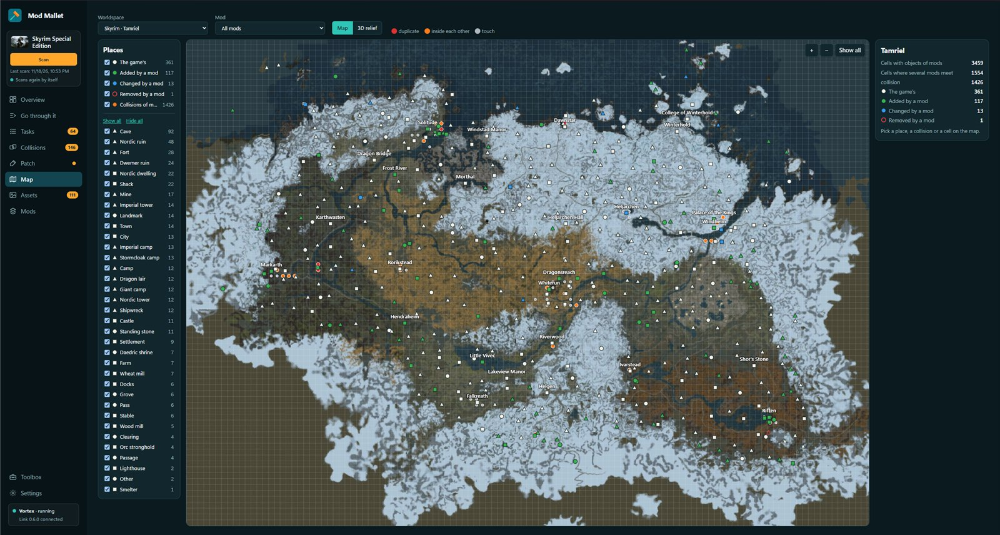
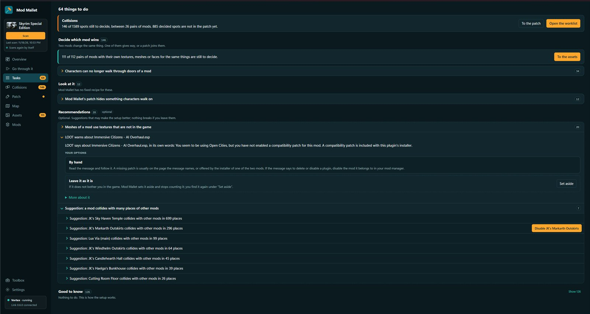
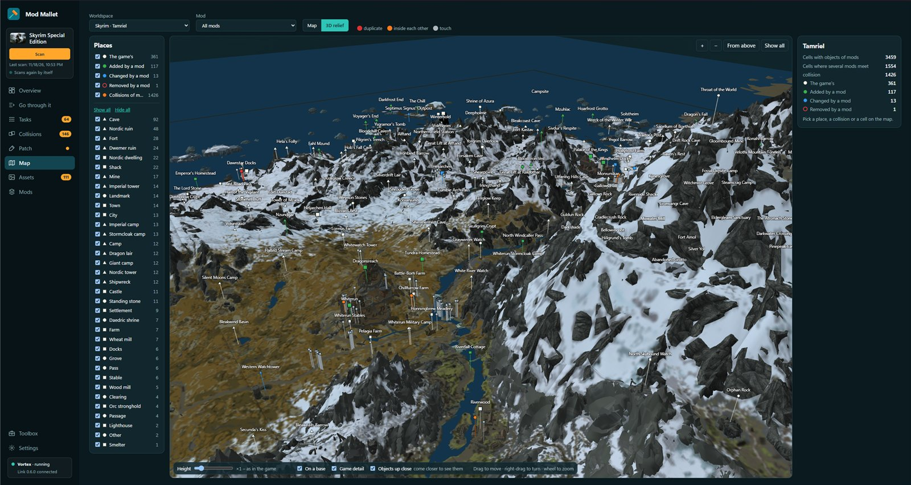
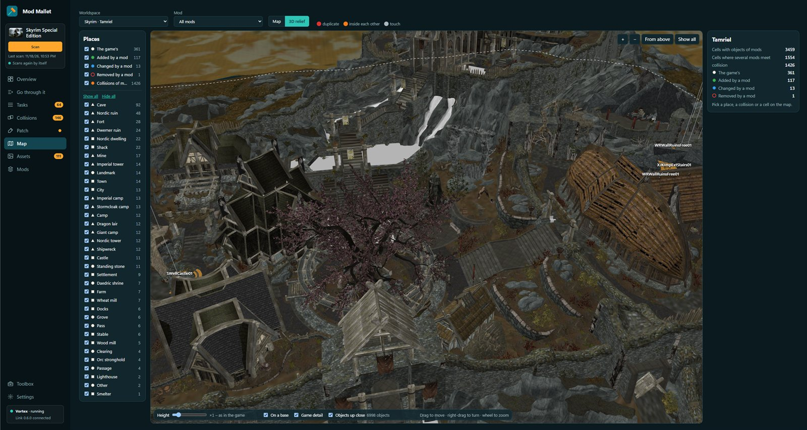

<p align="center">
  
</p>

<h1 align="center">Mod Mallet</h1>

<p align="center">
  <strong>Find out why your modded Skyrim crashes or looks wrong, and fix it
  without breaking anything.</strong>
</p>

<p align="center">
  <a href="LICENSE">GPL-3.0-or-later</a> · Windows · Skyrim Special Edition
  with Vortex · pre-release
</p>

<p align="center">
  
</p>

---

You installed a lot of mods. Now the game crashes now and then, and it does
not look the way you wanted: a fence runs through a house, a rock floats in
the air, a road turns into a different style halfway. Somewhere among a few
hundred mods something does not fit, but which one, and why?

Mod Mallet reads your setup, tells you in plain words what is wrong and why
it matters in the game, and offers fixes that you can undo. It works next to
the tools you already use, Vortex and LOOT, instead of replacing them.

## Find, understand, fix

| Find | Understand | Fix |
|---|---|---|
| One list of what is wrong, ordered by what matters most, each in a sentence you can read without knowing modding tools. | See the problem where it is: on the map, in 3D up close, or as the same thing side by side in every mod that changes it. | Let Vortex reinstall a mod with the options it missed, or hide colliding objects with a small patch of Mod Mallet's own. Switch it off and everything is as before. |

<p align="center">
  
</p>

## What you see

**The land in 3D.** Every place of the game and of your mods on the game's
own land and level of detail, with the mountains where they are.

<p align="center">
  
</p>

**Up close.** Come closer and the objects themselves appear, as the game
places them. A collision opens right where it is: pick what should stay, and
Mod Mallet builds the patch.

<p align="center">
  
</p>

<!-- Later: a short animation from the whole map into Whiterun, opening a
     collision and hiding the banner pole that runs through the pavilion. -->

**Side by side.** The same thing as every mod that changes it has it, so you
can choose the version you like.

**Crashes.** When a crash logger is installed, Mod Mallet reads its recent
reports and says which mods they point at, and how sure that is.

**And more.** Script extender plugins the game switched off, patches an
installer would offer now but that were never installed, characters with dark
faces, meshes made for the 2011 Skyrim, missing textures, characters' paths
that a later mod undoes, plugins LOOT warns about, and more. Everything Mod
Mallet can report is in the [finding catalog](docs/src/reference/findings.md).

## What it does not do

- **It changes nothing on its own.** A scan only reads. Every change goes
  through your mod manager, and only when you ask for it.
- **It is not a mod manager.** Vortex keeps installing, enabling and sorting
  your mods.
- **It never touches your mods.** What Mod Mallet makes lives in a separate
  mod that you can switch off.
- **It stays on your computer.** No account, no telemetry.

## Where it stands

Mod Mallet is in development and has no release to download yet.

- **Skyrim Special Edition with Vortex** is what it is built and tested with.
- **Skyrim (2011), Skyrim VR, Fallout 4, Fallout 4 VR, New Vegas, Fallout 3
  and Oblivion** are found and get the checks that their shared file formats
  allow.
- **Mod Organizer 2** is planned.

The app speaks English and German. See the [roadmap](docs/src/product/roadmap.md)
for what comes next.

<details>
<summary><strong>Building it yourself</strong></summary>

You need [Rust](https://rustup.rs) and [Node.js](https://nodejs.org) 22 or
newer, and on Windows the Visual Studio Build Tools. Details are in
[Development setup](docs/src/contributing/setup.md).

```text
npm install
npm run desktop -- dev              # the desktop app
cargo run -p mallet-cli -- scan     # the command line
cargo xtask ci                      # every check CI runs
```

</details>

## Documentation

The documentation is a book in [`docs/`](docs/src/SUMMARY.md); build and open
it with `cargo xtask docs --open`. Good places to start:

- [Vision and non-goals](docs/src/product/vision.md): what Mod Mallet is for
  and what it will not become.
- [Architecture overview](docs/src/architecture/overview.md): how the code is
  organised.
- [Decisions](docs/src/adr/README.md): why it is organised that way.

## Contributing

Contributions are welcome. Read [CONTRIBUTING.md](CONTRIBUTING.md) first.

## License

Mod Mallet is free software under the
[GNU General Public License, version 3 or later](LICENSE).

Mod Mallet is not affiliated with Bethesda Softworks, Nexus Mods, the LOOT
project or the Rust Foundation. Pictures in this file show the game's and
mods' own content as Mod Mallet displays it; they belong to their authors.
