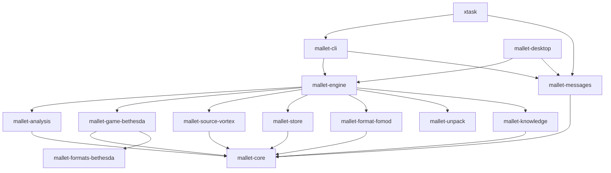

# Crates and their rules

The workspace is split into crates so that the compiler enforces the
architecture. A crate can only use what it depends on, and the allowed
dependencies are few.

| Crate | Responsibility | May depend on (inside the workspace) |
|---|---|---|
| `mallet-core` | Domain model: facts, findings, kinds, actions, the report, and the traits `ModSource` and `TextCache`. No I/O. | nothing |
| `mallet-analysis` | Pure functions from facts to findings. | `mallet-core` |
| `mallet-messages` | Texts in every language; renders findings. | `mallet-core` |
| `mallet-store` | SQLite cache: the last report, and texts that are slow to obtain. | `mallet-core` |
| `mallet-formats-bethesda` | Reads the structure of plugins, archives and meshes, the formats shared by Bethesda's games. No knowledge of what a record means. | nothing |
| `mallet-game-bethesda` | Finds the games of the Bethesda family on the machine (Skyrim SE, Skyrim VR, Skyrim, Fallout 4, Fallout 4 VR, New Vegas, Fallout 3, Oblivion, Oblivion Remastered), reads their installations, and knows what their records mean (ADR 0036). | `mallet-core`, `mallet-formats-bethesda` |
| `mallet-format-fomod` | Reads FOMOD installer descriptions into the installer model of `mallet-core`. | `mallet-core` |
| `mallet-unpack` | Reads single files out of mod archives by running a 7-Zip that is on the machine. | nothing |
| `mallet-source-vortex` | Reads Vortex's deployment manifest and saved state; implements `ModSource`; asks a running Vortex to act, through the extension in `integrations/vortex-extension`. | `mallet-core` |
| `mallet-knowledge` | Reads community-maintained rules about plugins, the LOOT masterlist, and evaluates their conditions with LOOT's own library (ADR 0030). | `mallet-core` |
| `mallet-engine` | Runs a scan, hands actions to the mod manager and keeps the user's settings. The only crate that connects adapters, analyses and the store. | all of the above except `mallet-messages` |
| `mallet-cli` | The `mallet` command. | `mallet-engine`, `mallet-messages`, `mallet-core` |
| `mallet-desktop` | The Tauri app (`apps/desktop/src-tauri`). | `mallet-engine`, `mallet-messages`, `mallet-core` |
| `xtask` | Project automation. | anything |

## The rules

1. **`mallet-core` depends on no other workspace crate** and performs no file,
   process or network access.
2. **Analyses, messages, the store and adapters depend on `mallet-core`
   only.** An analysis can therefore never reach into a game or a mod
   manager, and an adapter can never depend on another adapter.
3. **Only `mallet-engine` wires things together.**
4. **The command line and the desktop app decide nothing.** If a shell needs
   logic, the logic belongs in the engine so the other shell gets it too.

Rules 1 and 2 are checked by `cargo xtask ci`, which reads the dependency
graph and fails if a crate depends on something it may not. A new crate has
to be added to the table in `xtask/src/architecture.rs` to pass.

## Crates that do not exist yet

Crates are created when the first code for them is written, not before. An
empty crate proves nothing and goes stale. Expected next:

- `mallet-source-mo2` for Mod Organizer 2.
