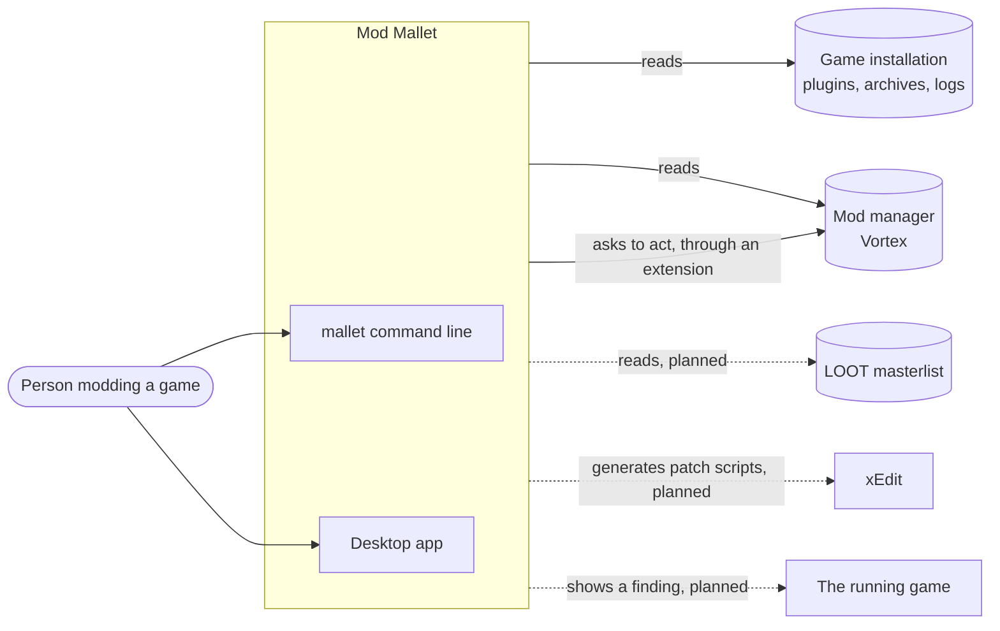
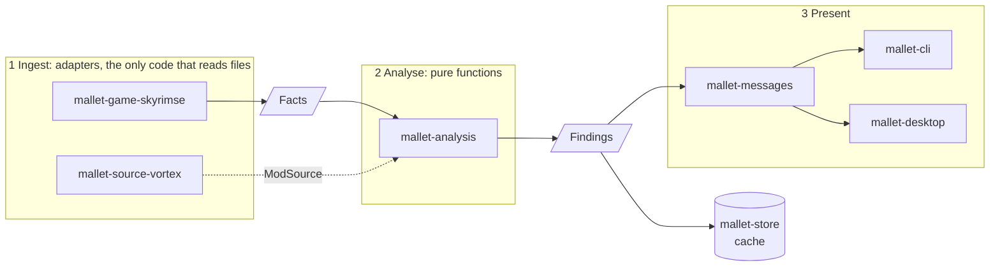

# Overview

Mod Mallet is a pipeline. Adapters read a setup and state facts, analyses
turn facts into findings, and a presentation layer puts findings into words.
Each stage knows only the one before it.

## Mod Mallet and its surroundings

Solid arrows exist today. Dashed arrows are on the
[roadmap](../product/roadmap.md). Mod Mallet never writes into the game
installation or a mod directly: changes go through the tools that own them
([ADR 0005](../adr/0005-read-only-and-reversible.md)). A finding lists the
actions that would address it, and an action is handed to the mod manager
only when the user asks for it
([ADR 0020](../adr/0020-actions-through-the-mod-manager.md)).

## The pipeline

1. **Ingest.** An adapter knows one game or one mod manager. It reads files
   and logs and produces game-neutral [`Facts`]. Parsing itself is a pure
   function from text or bytes to data, so it can be tested and fuzzed
   without a disk.
2. **Analyse.** An analysis receives facts and a [`ModSource`] and returns
   findings. It cannot open a file even if it wanted to: its crate depends on
   `mallet-core` only.
3. **Present.** A finding carries a kind and arguments, no prose.
   `mallet-messages` renders it in the reader's language. The command line
   and the desktop app are thin shells around the same engine.

`mallet-engine` is the one crate that wires the stages together.

## What one scan does today

1. Locate the game (registry) and the script extender's log, and remember
   each place for the report ([ADR 0018](../adr/0018-ask-before-reading.md)).
2. Parse the log into an `ExtenderReport`: which DLLs were examined and what
   happened to each.
3. Read the load order, list the loose files of the data directory, read
   the file list of every archive the game loads, and read the character
   records of every active plugin. For every loose mesh that also exists in
   an archive, read which textures both versions use.
4. Read Vortex's deployment manifest, if there is one, to learn which mod
   each deployed file belongs to, and the backup of Vortex's state for the
   mods' names and the options chosen in their installers.
5. Read the installer description of every deployed mod that has one, out
   of the archive the mod was installed from
   ([ADR 0019](../adr/0019-archives-through-7zip.md)).
6. Run the analyses: plugins the script extender did not load, characters
   whose face files do not match the winning record, installer options that
   fit the setup now but were not installed, replacement meshes that no
   longer use the textures a texture mod replaces, and files in a mod's
   archive that are replaced by loose files or by a later archive.
7. Sort the findings, most severe first, and cache the report.

On a setup with several hundred plugins and archives, reading the game's
files takes a few seconds, because only directories and the requested
record groups are read, never whole files. Those facts are held in memory.

Two steps are slow: looking into mod archives for installers, and opening
several thousand meshes. Their results are kept in the store under the size
and date of the files they came from, so only the first scan pays for them
([ADR 0006](../adr/0006-store-is-a-cache.md)). Adapters reach the store
through the `TextCache` trait of `mallet-core` and do not depend on it.

## Where things are kept

| What | Where | Lifetime |
|---|---|---|
| Result of the last scan, installer descriptions read from archives, textures of compared meshes | SQLite cache in the user's local application data | Rebuilt at will ([ADR 0006](../adr/0006-store-is-a-cache.md)) |
| Decisions such as "ignore this finding" | A separate versioned file (not built yet) | Must survive updates |
| Anything in the game or mod directories | Never written by Mod Mallet | |

[`Facts`]: ../adr/0004-pipeline.md
[`ModSource`]: ../adr/0009-mod-managers.md
